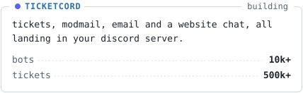
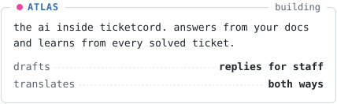
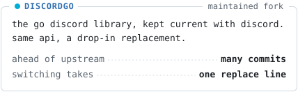
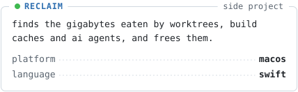
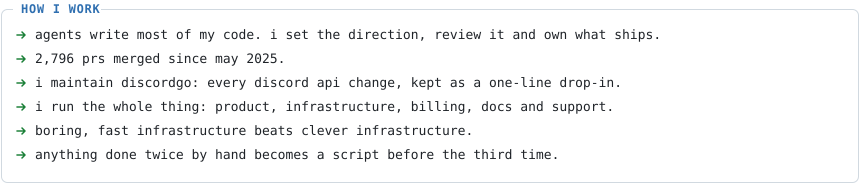

<picture><source srcset="cards/stats-dark.svg" media="(prefers-color-scheme: dark)"></picture>

<a href="https://ticketcord.com"><picture><source srcset="cards/tiles/ticketcord-dark.svg" media="(prefers-color-scheme: dark)"></picture></a>
<a href="https://ticketcord.com/docs/ai/atlas"><picture><source srcset="cards/tiles/atlas-dark.svg" media="(prefers-color-scheme: dark)"></picture></a>
 
<a href="https://github.com/0x00-sys/discordgo"><picture><source srcset="cards/tiles/discordgo-dark.svg" media="(prefers-color-scheme: dark)"></picture></a>
<a href="https://github.com/0x00-sys/Reclaim"><picture><source srcset="cards/tiles/reclaim-dark.svg" media="(prefers-color-scheme: dark)"></picture></a>

<picture><source srcset="cards/notes-dark.svg" media="(prefers-color-scheme: dark)"></picture>

